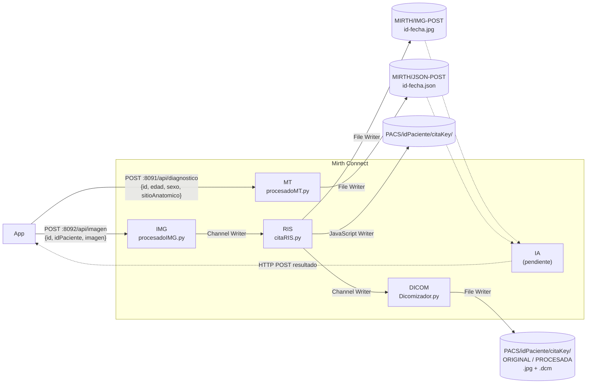

# Circuito de integración con Mirth Connect

Mirth Connect (4.5.2) es el integrador del sistema: recibe lo que envía la app, ejecuta los
scripts de Python y deja cada resultado donde lo necesita el siguiente paso (RIS, PACS e IA).
Corresponde al apartado 6.2.4 *Integrador* de la memoria del TFG.



## Contenido

```
mirth/
├── canales/TFG.xml        Grupo de canales "TFG" exportado de Mirth Connect 4.5.2
├── scripts/
│   ├── procesadoIMG.py    Canal IMG: preprocesado de la foto
│   ├── procesadoMT.py     Canal MT: codificación de los metadatos para la IA
│   ├── citaRIS.py         Canal RIS: alta de la cita en el RIS
│   ├── Dicomizador.py     Canal DICOM: archivo en el PACS en DICOM
│   └── requirements.txt
└── probar_circuito.py     Ejecuta el circuito completo en local, sin Mirth
```

## Canales

| Canal | Entrada | Script | Salida |
|---|---|---|---|
| **IMG** | HTTP Listener `:8092/api/imagen` | `procesadoIMG.py <json temporal>` | Channel Writer → RIS |
| **RIS** | Channel Reader | `citaRIS.py <json temporal>` | File Writer `MIRTH/IMG-POST/${idImagen}-${DATE}.jpg`<br/>JavaScript Writer: crea `PACS/<idPaciente>/<citaKey>/`<br/>Channel Writer → DICOM |
| **DICOM** | Channel Reader | `Dicomizador.py <json temporal>` | File Writer `PACS/${Id}/${Ruta}/ORIGINAL_${DATE}.jpg` y `PROCESADA_${DATE}.jpg` |
| **MT** | HTTP Listener `:8091/api/diagnostico` | `procesadoMT.py <json>` | File Writer `MIRTH/JSON-POST/${Id}-${DATE}.json` |
| **IA** | JavaScript Reader (cada 5 s) | — | HTTP Sender (sin configurar). Canal desactivado |

La app tiene que usar el **mismo `id`** en las dos peticiones: el canal IA empareja el JSON de
`JSON-POST` con la imagen de `IMG-POST` por ese identificador.

## Qué hace cada script

Todos siguen el contrato de su canal: Mirth los lanza con `cmd /c python.exe script.py <arg>`,
junta stderr con stdout y hace `JSON.parse` de la salida, así que **solo imprimen un JSON**.
Si algo falla imprimen `{"error": "..."}` y terminan con código 1.

### procesadoIMG.py (canal IMG)

Aplica a la foto los mismos filtros que al dataset de entrenamiento: eliminación de vello
(DullRazor), realce con CLAHE y normalización de color.

- Entrada (fichero): `{"id", "idPaciente", "imagen"}`. La imagen va en base64 (JPEG o PNG, también como data URL).
- Salida: `{"id", "idPaciente", "imagenOriginal", "imagenProcesada"}`, las dos en JPEG base64.

### citaRIS.py (canal RIS)

Da de alta la cita en el RIS: genera la `citaKey` (`AAAAMMDDhhmmss-<id>`) y la guarda en la
base de datos del RIS (SQLite `ris.db`, o la ruta de `RIS_DB`) con estado `PENDIENTE_INFORME`.

- Entrada (fichero): la salida de `procesadoIMG.py`.
- Salida: `{"citaKey", "idPaciente", "idImagen", "fecha", "imagen"}`. `imagen` es la imagen procesada que el canal guarda en `IMG-POST`.

### Dicomizador.py (canal DICOM)

Convierte la imagen original y la procesada a DICOM (Secondary Capture, modalidad `XC`, RGB,
mismo estudio y una serie para cada una) y las guarda como `ORIGINAL.dcm` y `PROCESADA.dcm`
en `PACS/<idPaciente>/<citaKey>/` (carpeta del PACS en `PACS_DIR`).

- Entrada (fichero): `{"Cita": <salida de citaRIS>, "Dicom": <salida de procesadoIMG>, "Id"}`.
- Salida: `{"citaKey", "idPaciente", "imagenOriginal", "imagenProcesada", "dicom"}`. El canal guarda además las dos imágenes en JPEG en la misma carpeta.

### procesadoMT.py (canal MT)

Pasa los datos del formulario a las variables con las que se entrenó el modelo multimodal
(`ProcesamientoMT.py` sobre ISIC 2019):

- `age_approx`: edad redondeada de 5 en 5, como en ISIC.
- `sex_num`: `female` = 0, `male` = 1.
- `anatom_site_code`: código de `LabelEncoder` (orden alfabético: 0 anterior torso, 1 head/neck,
  2 lateral torso, 3 lower extremity, 4 oral/genital, 5 palms/soles, 6 posterior torso,
  7 upper extremity). El desplegable de la app usa **otro orden** (0 Anterior Torso,
  1 Upper Extremity, 2 Posterior Torso…), así que el script traduce el número de la app al
  sitio y del sitio al código del modelo.
- Si falta un dato se imputa con la mediana o la moda del conjunto de entrenamiento (edad 55,
  `male`, `anterior torso`) y se indica en `imputados`.

Mirth le pasa el JSON como argumento (no como fichero). Al pasar por `cmd /c` Windows puede
quitarle las comillas, por eso también acepta `{id:17,edad:45,sexo:Male,sitioAnatomico:5}`.

- Entrada: `{"id", "idPaciente", "edad", "sexo", "sitioAnatomico"}`.
- Salida: `{"id", "idPaciente", "edad", "sexo", "sitioAnatomico", "age_approx", "sex_num", "anatom_site_code", "imputados"}`.

## Instalación en el servidor de Mirth (Windows)

Los canales usan rutas absolutas del servidor donde se montó el TFG:

```
C:\Users\Administrador\Desktop\
├── Python313\python.exe
├── MIRTH\
│   ├── SCRIPTS\           ← los .py de mirth/scripts
│   ├── IMG-POST\TEMP\
│   ├── JSON-POST\
│   └── RIS\TEMP1\  RIS\TEMP2\
└── PACS\
```

1. Crear esas carpetas y copiar `scripts/*.py` en `MIRTH\SCRIPTS`.
2. Instalar las dependencias: `C:\Users\Administrador\Desktop\Python313\python.exe -m pip install -r requirements.txt`.
3. En Mirth Connect Administrator: *Channels → Import Group* → `canales/TFG.xml`, y desplegar los canales.

Si el servidor es otro, hay que cambiar `pythonPath`, `scriptPath` y las carpetas en los
transformers de cada canal y en los File Writer.

## Probar el circuito sin Mirth

`probar_circuito.py` llama a los scripts exactamente como los canales y escribe lo mismo que
escribirían los File Writer, en `mirth/salida_prueba/`:

```bash
pip install -r mirth/scripts/requirements.txt
python mirth/probar_circuito.py assets/casos/caso-1a.jpg --id 17 --edad 45 --sexo Male --sitio 5
```

```
salida_prueba/
├── MIRTH/JSON-POST/17-<fecha>.json
├── MIRTH/IMG-POST/17-<fecha>.jpg
├── PACS/10293847/<citaKey>/ORIGINAL.dcm  PROCESADA.dcm  ORIGINAL_<fecha>.jpg  PROCESADA_<fecha>.jpg
└── ris.db
```

## Origen de estos ficheros

- **`canales/TFG.xml`** es la exportación del grupo de canales del 27/03/2025, con tres
  cambios para dejar el circuito tal y como se describe en la memoria:
  - Se ha quitado el canal de pruebas `DICOM-PRUEBA` (lanzaba `DicomizadorCOPIA.py` y solo
    registraba la salida en el log).
  - El canal RIS envía al canal `DICOM`; en la exportación seguía apuntando a `DICOM-PRUEBA`.
  - El canal IMG llama a `procesadoIMG.py` en lugar de a la copia `procesadoIMG-PRUEBA.py`.
- **Los scripts de `scripts/` están reconstruidos.** Los originales estaban solo en el
  servidor Windows de Mirth y no se conservaron. Se han vuelto a escribir a partir del código
  JavaScript de cada canal (qué recibe cada script y qué campos lee de su salida) y del
  preprocesado original del TFG (`ProcesamientoIMG.py`, `ProcesamientoMT.py` y `dicom.py`).
- **El canal IA** está vacío y desactivado en la exportación. Según la memoria, cada pocos
  segundos busca en `JSON-POST` e `IMG-POST` un JSON y una imagen con el mismo `id`, ejecuta
  el clasificador y envía la predicción por HTTP POST (`application/json`).
